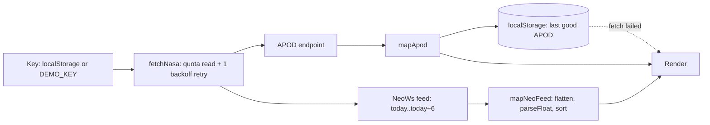

# Architecture — NASA Space Dashboard

**Shape:** three static files — `index.html`, `styles.css`, `app.js`. No build, no framework. The two sections (APOD, asteroids) load and fail **independently** — one section's error never blanks the other.

**Data flow:**

**Layers inside app.js:**
1. **API layer** — `fetchNasa()` reads `X-RateLimit-*` headers on every response, retries 5xx/network once after 1.2 s, never retries 429, throws typed errors.
2. **Mapper layer** — `mapApod()` (media typing, credit normalisation), `mapNeoFeed()` (date-keyed object → flat array, string numbers parsed, diameter averaged, sorted by miss distance).
3. **State** — quota snapshot, selected APOD date.
4. **Render** — per-section renderers with independent status/error regions.

**Caching:** only the last successful APOD persists (fallback content); asteroid data is deliberately not cached — stale approach data would mislead.
